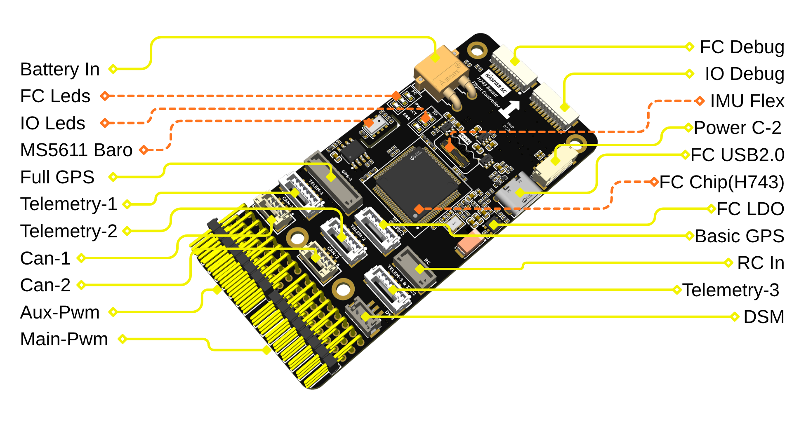
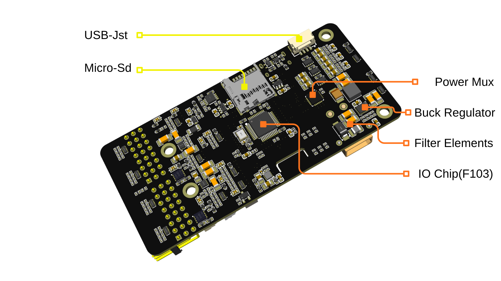

# NASPIER 6C Flight Controller

The NASPIER 6C is an FMUv6C-class flight controller designed by [Naspaw](https://github.com/naspaw/NASPIER_6C). It pairs an STM32H743 flight management unit (FMU) with an STM32F103 IO co-processor (IOMCU). The IMUs, magnetometer and IMU heater sit on a separate sensor board, connected to the main board with a flex cable.



## Where to Buy

The board is not available for purchase yet. It is in the pre-production stage.

## Specifications

- Processors

  - STM32H743 32-bit processor, 480 MHz, 2 MB flash, 1 MB RAM
  - STM32F103 IOMCU

- Sensors

  - Bosch BMI088 IMU (accel, gyro), on the sensor board
  - TDK InvenSense IIM-42653 industrial IMU (accel, gyro), on the sensor board
  - IMU heater on the sensor board
  - MEAS MS5611 barometer, on the main board
  - iSentek IST8310 magnetometer, on the sensor board

- Storage

  - 32 KB FRAM (FM25V02A) for parameters
  - microSD card for logging

- Interfaces

  - 16 PWM outputs: 8 from the IOMCU, 8 from the FMU
  - 6 UARTs: TELEM1 and TELEM2 with flow control, TELEM3, GPS1, GPS2 and debug
  - 2 CAN ports
  - 2 external I2C buses (GPS1, and GPS2 shared with TELEM3)
  - PPM/SBUS RC input, DSM satellite input, SBUS output
  - Safety switch and buzzer through the GPS1 connector
  - USB Type-C, plus a JST GH USB connector
  - Separate debug connectors for the FMU and the IOMCU

- Power

  - Direct battery input on XT30, 4S to 12S, with an onboard 5V regulator and voltage sensing
  - Brick input on JST GH 6 pin for an analog power module, with voltage and current sensing
  - USB input, 4.7V to 5.2V
  - LTC4417 power selection with this priority: Direct battery, then Brick input, then USB
  - Current limited 5V rails for peripherals, with overcurrent reporting
  - Servo rail is powered separately and is not powered by the board

- Dimensions

  - Size: 90 x 42 mm
  - Mounting: 4x 3 mm holes

## Pinout




All signal connectors are JST GH (1.25 mm pitch) unless stated otherwise.

### GPS1 (Full GPS), JST GH 10 pin

| Pin | Signal | Volt |
| --- | --- | --- |
| 1 | VCC | +5V |
| 2 | TX (OUT, USART1) | +3.3V |
| 3 | RX (IN, USART1) | +3.3V |
| 4 | SCL (I2C1) | +3.3V |
| 5 | SDA (I2C1) | +3.3V |
| 6 | Safety switch button | +3.3V |
| 7 | Safety switch LED | +3.3V |
| 8 | Safety switch VCC | +3.3V |
| 9 | Buzzer - | +5V |
| 10 | GND | GND |

### GPS2 (Basic GPS), JST GH 6 pin

| Pin | Signal | Volt |
| --- | --- | --- |
| 1 | VCC | +5V |
| 2 | TX (OUT, UART8) | +3.3V |
| 3 | RX (IN, UART8) | +3.3V |
| 4 | SCL (I2C2) | +3.3V |
| 5 | SDA (I2C2) | +3.3V |
| 6 | GND | GND |

### TELEM1, TELEM2, JST GH 6 pin

| Pin | Signal | Volt |
| --- | --- | --- |
| 1 | VCC | +5V |
| 2 | TX (OUT) | +3.3V |
| 3 | RX (IN) | +3.3V |
| 4 | CTS | +3.3V |
| 5 | RTS | +3.3V |
| 6 | GND | GND |

### TELEM3 and I2C2, JST GH 6 pin

The I2C2 bus is shared with the GPS2 connector.

| Pin | Signal | Volt |
| --- | --- | --- |
| 1 | VCC | +5V |
| 2 | TX (OUT, USART2) | +3.3V |
| 3 | RX (IN, USART2) | +3.3V |
| 4 | SCL (I2C2) | +3.3V |
| 5 | SDA (I2C2) | +3.3V |
| 6 | GND | GND |

### CAN1, CAN2, JST GH 4 pin

| Pin | Signal | Volt |
| --- | --- | --- |
| 1 | VCC | +5V |
| 2 | CAN_H | +12V |
| 3 | CAN_L | +12V |
| 4 | GND | GND |

### RC IN, JST GH 5 pin

| Pin | Signal | Volt |
| --- | --- | --- |
| 1 | VCC | +5V |
| 2 | PPM/SBUS input (IOMCU) | +3.3V |
| 3 | Not connected | - |
| 4 | SBUS output (IOMCU) | +3.3V |
| 5 | GND | GND |

### DSM, JST ZH 3 pin

| Pin | Signal | Volt |
| --- | --- | --- |
| 1 | VCC (switched by the IOMCU) | +3.3V |
| 2 | DSM input (IOMCU) | +3.3V |
| 3 | GND | GND |

### Brick input, JST GH 6 pin

| Pin | Signal | Volt |
| --- | --- | --- |
| 1 | VCC | +5V |
| 2 | VCC | +5V |
| 3 | Current sense | +3.3V |
| 4 | Voltage sense | +3.3V |
| 5 | GND | GND |
| 6 | GND | GND |

### PWM outputs, 2x 3x8 pin headers

Each header has a signal row, a servo power row and a GND row. The servo power row is shared by both headers and must be powered from an external BEC or ESC.

### Debug connectors, JST SH 10 pin

- FC Debug: FMU SWD, reset and debug UART (USART3, SERIAL6)
- IO Debug: IOMCU SWD, SWO, reset and debug UART

## UART Mapping

All UARTs have DMA on TX and RX.

| Port | UART | Connector | Default protocol | Notes |
| --- | --- | --- | --- | --- |
| SERIAL0 | OTG1 | USB | MAVLink2 | |
| SERIAL1 | UART7 | TELEM1 | MAVLink2 | RTS/CTS |
| SERIAL2 | UART5 | TELEM2 | MAVLink2 | RTS/CTS |
| SERIAL3 | USART1 | GPS1 | GPS | |
| SERIAL4 | UART8 | GPS2 | GPS | |
| SERIAL5 | USART2 | TELEM3 | None | |
| SERIAL6 | USART3 | FC Debug | None | |
| SERIAL7 | OTG2 | USB | MAVLink2 | second USB interface |

USART6 connects the FMU to the IOMCU and is not available to the user.

## RC Input

The PPM/SBUS pin on the RC IN connector is read by the IOMCU. It supports all unidirectional RC protocols: PPM, SBUS, iBus, SUMD, SRXL, ST24 and FPort (RC only, without telemetry).

DSM, DSM2 and DSM-X satellite receivers connect to the DSM connector. The IOMCU switches the 3.3V supply of this connector, which is used for DSM binding.

Bi-directional protocols such as CRSF/ELRS, SRXL2, IRC Ghost, and FPort with telemetry need a full UART. For example, on TELEM2 (SERIAL2):

- Set SERIAL2_PROTOCOL = 23 (RCIN)
- CRSF/ELRS: SERIAL2_OPTIONS = 0
- FPort: SERIAL2_OPTIONS = 15
- SRXL2: SERIAL2_OPTIONS = 4, and connect only the TX pin

See [Radio Control Systems](https://ardupilot.org/copter/docs/common-rc-systems.html) for details.

### SBUS output

The IOMCU can output SBUS on pin 4 of the RC IN connector. Set BRD_SBUS_OUT to the required frame rate to enable it.

## PWM Outputs

The NASPIER 6C supports up to 16 PWM outputs.

ArduPilot numbers the IOMCU outputs first. The header driven by the IOMCU gives SERVO1 to SERVO8, and the header driven by the FMU gives SERVO9 to SERVO16.

The 8 IOMCU outputs are in 3 groups:

- SERVO1 and SERVO2 in group 1 (TIM2)
- SERVO3 and SERVO4 in group 2 (TIM4)
- SERVO5 to SERVO8 in group 3 (TIM3)

The IOMCU outputs support PWM. They support DShot when BRD_IO_DSHOT = 1, which loads the DShot IOMCU firmware.

The 8 FMU outputs are in 3 groups:

- SERVO9 to SERVO12 in group 4 (TIM1)
- SERVO13 and SERVO14 in group 5 (TIM4)
- SERVO15 and SERVO16 in group 6 (TIM5)

The FMU outputs support PWM, OneShot and DShot.

Channels within the same group need to use the same output rate. If any channel in a group uses DShot, then all channels in the group need to use DShot.

## GPIOs

The FMU PWM outputs can be used as GPIOs (relays, buttons, RPM etc). To use them, set the SERVOx_FUNCTION parameter of the output to -1.

| Pin | GPIO number |
| --- | --- |
| FMU PWM 1 (SERVO9) | 50 |
| FMU PWM 2 (SERVO10) | 51 |
| FMU PWM 3 (SERVO11) | 52 |
| FMU PWM 4 (SERVO12) | 53 |
| FMU PWM 5 (SERVO13) | 54 |
| FMU PWM 6 (SERVO14) | 55 |
| FMU PWM 7 (SERVO15) | 56 |
| FMU PWM 8 (SERVO16) | 57 |
| Buzzer (ALARM) | 77 |
| IMU heater | 80 |
| Red LED | 90 |
| Blue LED | 92 |

## Battery Monitoring

The board has two battery monitor inputs.

The Direct battery input (XT30) has a voltage divider, which can measure up to about 56V (12S). The current sense amplifier is not populated on this input, so the default monitor type is voltage only.

The default battery parameters are:

- BATT_MONITOR = 3
- BATT_VOLT_PIN = 8
- BATT_VOLT_MULT = 17.12

If the INA168 current sense amplifier is fitted, set:

- BATT_MONITOR = 4
- BATT_CURR_PIN = 4
- BATT_AMP_PERVLT = 20.08

The Brick input accepts an analog power module. It is disabled by default. To use it, set:

- BATT2_MONITOR = 4
- BATT2_VOLT_PIN = 5
- BATT2_CURR_PIN = 14
- BATT2_VOLT_MULT = 18.18 (adjust for the power module in use)
- BATT2_AMP_PERVLT = 36.36 (adjust for the power module in use)

## Compass

The NASPIER 6C has a built-in IST8310 compass on the sensor board. Due to potential interference, the autopilot is usually used with an external I2C compass as part of a GPS/Compass combination.

## IMU Heater

The IMU heater on the sensor board is controlled by the FMU. The default target temperature is 45°C, and can be changed with BRD_HEAT_TARG.

## Firmware

This board is not an official ArduPilot target, and firmware is not available on the firmware server. Build it with:

```bash
./waf configure --board NASPIER6C
./waf copter
```

## Loading Firmware

This board does not come with ArduPilot firmware pre-installed. The first time, load the `arducopter_with_bl.hex` file (or the one for your vehicle) over SWD on the FC Debug connector, or over USB DFU with BOOT0 held high. See [Loading Firmware onto boards without existing ArduPilot firmware](https://ardupilot.org/copter/docs/common-loading-firmware-onto-chibios-only-boards.html).

After that, load `.apj` firmware files with any ArduPilot compatible ground station.

## Other Links

- [NASPIER 6C schematics and documentation](https://github.com/naspaw/NASPIER_6C)
